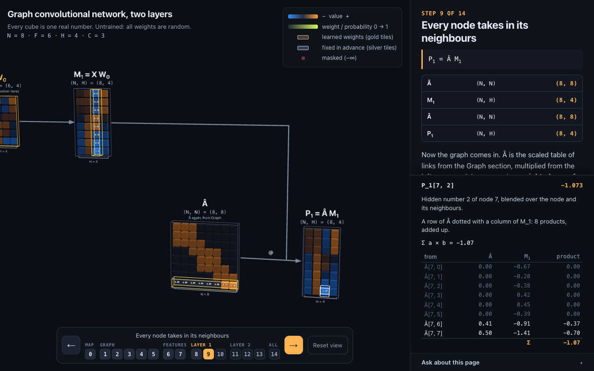

# model-arithmetic-3d

Interactive 3D pages that show exactly how a machine-learning model computes. Every number is one cube, every tensor carries its shape, and pointing at a cube lights up the numbers it was computed from.



The pages are not drawn by hand. A model is written once as a short program in a small tensor language, and a compiler derives the rest from it: positions, arrows, camera views, the text of each step, the highlight of every cube, and the checks.

## The models

| Page | Model | Size |
|---|---|---|
| `compiled.html` | GPT-style transformer, two blocks | 8,784 cubes, 25 steps |
| `compiled.html?program=yolo` | YOLOv3-style detector, one scale | 1,694 cubes, 13 steps |
| `compiled.html?program=sd` | Stable Diffusion v1-style text-to-image model | 24,350 cubes, 59 steps |
| `compiled.html?program=lstm` | LSTM language model, four time steps | 1,617 cubes, 16 steps |
| `compiled.html?program=gcn` | Graph convolutional network, two layers | 604 cubes, 15 steps |
| `compiled.html?program=gat` | Graph attention network, one layer | 1,024 cubes, 15 steps |


## What the pages do and do not claim

- **The arithmetic is the model's own.** Sizes are shrunk (a transformer with 12 numbers per token, not 768), but the calculation is not simplified. Where a page leaves something out, it says so: every program declares its departures from the real model, and the page lists them.
- **The weights are random.** No model here is trained. The pages show how the numbers flow, not what a trained model has learned. What trained models do is told in prose only, and marked as such.
- **The highlight is exact.** A cube lights exactly the cells it was computed from. A test checks this for every cube of every page.
- **The numbers are checked against a second calculation, not against a library.** For each model, a test recomputes every number with plain loops that share no code with the compiler. Both come from the same reading of the paper, so a misreading would pass. No page has yet been compared with PyTorch or with a paper's own code.
- **Two pages are less finished than the rest.** The Stable Diffusion page runs the whole pipeline on random weights, so its picture shows nothing. The graph attention network was written from memory of the paper and has not been checked against it.

## Run it

You need Python 3 and a browser. Three.js is loaded from a CDN, so the first load needs a network connection. There is nothing to install and no build step.

```bash
python3 serve.py 5173
```

Then open `http://localhost:5173/compiled.html`, or any page from the table above.

On a page: the arrow buttons move through the steps, pointing at a cube shows where its value came from, and a click pins it and lists the arithmetic.

## Check it

The tests need Node.js (written and run with Node 24) and nothing else.

```bash
npm test
```

To print what the compiler derives from a program (steps, tensors and shapes) without opening a browser:

```bash
PROGRAM=gcn npm run describe
```

## What a program looks like

Two steps of the graph convolutional network, from `programs/gcn.js`, shortened:

```js
const M1 = step('Every node’s own numbers are mixed', () => {
  const W0 = param('W0', 'W_{0}', [F, Hd], random(0.8));
  const M1 = matmul(X, W0).as('M1', 'M_{1}');

  say`Each node's row of ${F.size} numbers is multiplied with the weight table ${W0} and becomes a row of ${Hd.size}.`;
  M1.says`Hidden number ${col} of node ${row}, from its own features only.`;
  return M1;
});

const P1 = step('Every node takes in its neighbours', () => {
  const A1 = again(Ah).as('Ah1', 'Â');
  const P1 = matmul(A1, M1).as('P1', 'P_{1}');

  say`Now the graph comes in: every node's new row is a weighted sum of the rows of the nodes it is linked to.`;
  return P1;
});
```

The author writes why a step exists. What is computed, the formula, the shapes, the PyTorch line and the per-cube arithmetic are generated from the operations, so they cannot disagree with the numbers.

## Asking about a page

Every compiled page has an "Ask about this page" panel, where a viewer can ask a question and a Claude model answers with the page's own numbers. It is optional and off unless you set it up. It needs the `anthropic` Python package and an Anthropic API key, and each question is billed to that key.

```bash
python3 -m venv .venv
.venv/bin/pip install anthropic
.venv/bin/python serve.py 5173
```

Put the key in `~/.config/transformer-3d/.env` as a line `ANTHROPIC_API_KEY=...`. The top of `ask.py` explains the settings and why the file lives outside the project folder.

## Asking for a new model: two ways

The project is meant to be driven in plain language: "show me how a graph attention network works", with links to papers if you have them. An AI agent does the work and a person decides at each fork.

What the agent does is written down once, in `.claude/skills/add-model/SKILL.md`:

1. Research the model's exact arithmetic.
2. Propose a plan: which variant, the toy sizes, the steps, what will be left out, and what the compiler cannot draw.
3. Stop and wait for the person's decision.
4. Write the program and its tests, look at every step in a browser, and report.

When the compiler cannot draw something, the agent is told to say so and offer choices, never to fake it. The LSTM, the graph convolutional network and the graph attention network were added this way.

There are two ways to run that procedure. Both use the same skill file and the same compiler.

### 1. In Claude Code (the main way)

Open this folder in [Claude Code](https://claude.com/claude-code) and type:

```
/add-model graph attention network (Veličković et al., 2018), one layer
```

The agent researches, shows its proposal and waits for your answer. This is the way the project itself is developed, and the more useful of the two:

- **It is a conversation.** Before approving a proposal you can ask what the model does, why a step is there, or what an alternative would cost.
- **It does not end with the page.** The same session can fix a page, extend the compiler when a model needs a new operation, and commit the result.
- **It runs on whatever your Claude Code runs on**, for most people a Claude plan, with Claude Code's own permission prompts.

### 2. From a program of your own (an example)

`examples/agent-sdk/` is a terminal program of about 290 lines, built on the Claude Agent SDK. It loads the same skill and runs the same procedure without Claude Code:

```bash
cd examples/agent-sdk
npm install
node add-model.mjs "graph attention network (Veličković et al., 2018), one layer"
```

It exists to show that nothing here depends on Claude Code. The compiler and the skill can be built into another application, such as a teaching tool or a web service, and that application then decides what the agent may do. The example makes those decisions in the open:

- **What the agent may do without asking** is a short list in the source: read the project, write programs and tests, run the tests, look at a page in a headless Chrome.
- **Everything else is shown to you first**, including any change to the compiler.
- **It is billed to an Anthropic API key**, per token, and prints a running cost estimate.

It is an example, not a product: one answer per line, no way to resume a conversation. Its own [README](examples/agent-sdk/README.md) lists the limits. The graph attention network was added through it.

### Which one

| | Claude Code | The example program |
|---|---|---|
| Use it when | you want to add a model, or work on the project | you want to build something of your own on the compiler |
| You need | Claude Code | Node.js, Google Chrome, an Anthropic API key |
| Paid by | your Claude Code account, usually a Claude plan | the API key, per token |
| What the agent may do | Claude Code's permission settings | a list in `add-model.mjs`; the rest needs your yes |
| Models added so far | LSTM, graph convolutional network | graph attention network |

## Layout of the code

| Path | What it is |
|---|---|
| `lang/` | The tensor language and the compiler: operations, layout, scene, generated explanations, the source checker |
| `programs/` | One program per model |
| `runtime/`, `compiled.html` | The page a compiled program runs in, and the question panel |
| `src/`, `index.html` | An earlier transformer page written by hand, kept because a test compares the compiled one with it |
| `test/` | Tests: every number, every highlight, the layout |
| `tools/describe.mjs` | Prints a program's derived steps |
| `serve.py`, `ask.py` | The local server and the question panel's server side |
| `examples/agent-sdk/` | The authoring skill outside Claude Code |
| `HANDOFF.md` | Working notes: the rules of the project, the language in brief, the layout rules, each model's state, known problems and next steps |

`HANDOFF.md` is written for whoever continues the work, a person or an agent, and is the place to look before changing anything.

## Licence

MIT. See [LICENSE](LICENSE).
