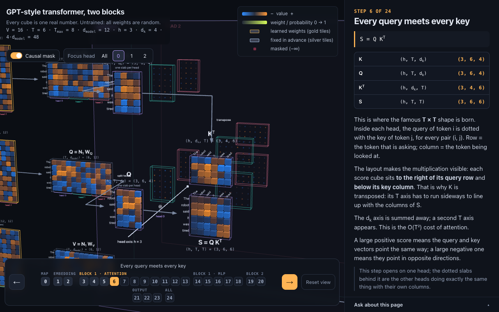
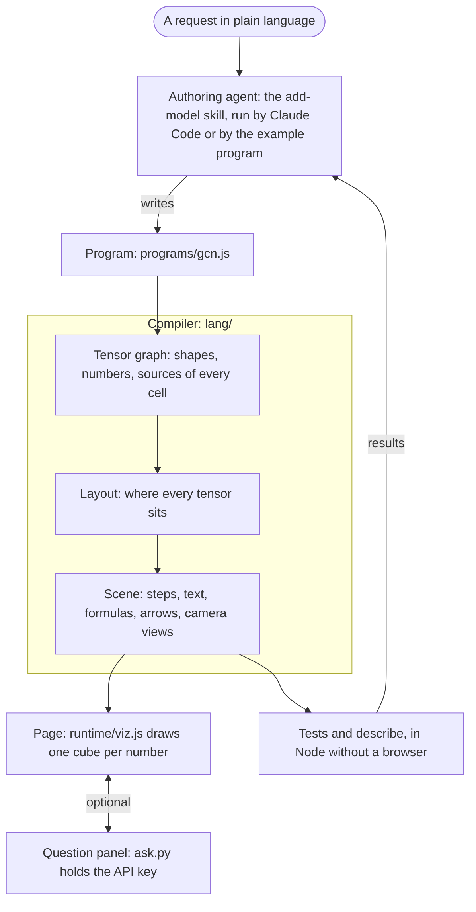

# model-arithmetic-3d

A generator of interactive 3D pages that show exactly how a machine-learning model computes. You describe a model as a short program, or ask an AI agent to write one, and a compiler produces the page: every number is one cube, every tensor carries its shape, and pointing at a cube lights up the numbers it was computed from.


No page is drawn by hand. From the program, written in a small tensor language, the compiler derives the rest: positions, arrows, camera views, the text of each step, the highlight of every cube, and the checks. The six pages below are what it has generated so far.

The generator is not finished, and is not meant to be. Every new model so far has needed something the compiler could not yet draw, so the agent that adds a model may also extend the compiler, with a person's approval. [More on this below.](#it-grows-with-every-model)

## The models

| Page | Model | Size |
|---|---|---|
| `compiled.html` | GPT-style transformer, two blocks | 8,784 cubes, 25 steps |
| `compiled.html?program=yolo` | YOLOv3-style detector, one scale | 1,694 cubes, 13 steps |
| `compiled.html?program=sd` | Stable Diffusion v1-style text-to-image model | 24,350 cubes, 59 steps |
| `compiled.html?program=lstm` | LSTM language model, four time steps | 1,617 cubes, 16 steps |
| `compiled.html?program=gcn` | Graph convolutional network, two layers | 604 cubes, 15 steps |
| `compiled.html?program=gat` | Graph attention network, one layer | 1,024 cubes, 15 steps |



## What the pages do and do not claim

- **The arithmetic is the model's own.** Sizes are shrunk (a transformer with 12 numbers per token, not 768), but the calculation is not simplified. Where a page leaves something out, it says so: every program declares its departures from the real model, and the page lists them.
- **The weights are random.** No model here is trained. The pages show how the numbers flow, not what a trained model has learned. What trained models do is told in prose only, and marked as such.
- **The highlight is exact.** A cube lights exactly the cells it was computed from. A test checks this for every cube of every page.
- **The numbers are checked against a second calculation, not against a library.** For each model, a test recomputes every number with plain loops that share no code with the compiler. Both come from the same reading of the paper, so a misreading would pass. No page has yet been compared with PyTorch or with a paper's own code.
- **Two pages are less finished than the rest.** The Stable Diffusion page runs the whole pipeline on random weights, so its picture shows nothing. The graph attention network was written from memory of the paper and has not been checked against it.

## Run it

You need Python 3 and a browser. Three.js is loaded from a CDN, so the first load needs a network connection. There is nothing to install and no build step.

```bash
python3 serve.py 5173
```

Then open `http://localhost:5173/compiled.html`, or any page from the table above.

On a page: the arrow buttons move through the steps, pointing at a cube shows where its value came from, and a click pins it and lists the arithmetic.

## Check it

The tests need Node.js (written and run with Node 24) and nothing else.

```bash
npm test
```

To print what the compiler derives from a program (steps, tensors and shapes) without opening a browser:

```bash
PROGRAM=gcn npm run describe
```

## What a program looks like

Two steps of the graph convolutional network, from `programs/gcn.js`, shortened:

```js
const M1 = step('Every node’s own numbers are mixed', () => {
  const W0 = param('W0', 'W_{0}', [F, Hd], random(0.8));
  const M1 = matmul(X, W0).as('M1', 'M_{1}');

  say`Each node's row of ${F.size} numbers is multiplied with the weight table ${W0} and becomes a row of ${Hd.size}.`;
  M1.says`Hidden number ${col} of node ${row}, from its own features only.`;
  return M1;
});

const P1 = step('Every node takes in its neighbours', () => {
  const A1 = again(Ah).as('Ah1', 'Â');
  const P1 = matmul(A1, M1).as('P1', 'P_{1}');

  say`Now the graph comes in: every node's new row is a weighted sum of the rows of the nodes it is linked to.`;
  return P1;
});
```

The author writes why a step exists. What is computed, the formula, the shapes, the PyTorch line and the per-cube arithmetic are generated from the operations, so they cannot disagree with the numbers.

## Asking about a page

Every compiled page has an "Ask about this page" panel, where a viewer can ask a question and a Claude model answers with the page's own numbers. It needs the `anthropic` Python package and an Anthropic API key, and each question is billed to that key.

The panel is optional. Without a key the pages work in full: the 3D scene, the steps, the text, and the highlight and arithmetic of every cube. Nothing but the panel calls a model. If you ask a question without a key, the panel answers with one line that says what is missing.

```bash
python3 -m venv .venv
.venv/bin/pip install anthropic
.venv/bin/python serve.py 5173
```

Put the key in `~/.config/model-arithmetic-3d/.env` as a line `ANTHROPIC_API_KEY=...`. The top of `ask.py` explains the settings and why the file lives outside the project folder.

## Asking for a new model: two ways

The project is meant to be driven in plain language: "show me how a graph attention network works", with links to papers if you have them. An AI agent does the work and a person decides at each fork.

What the agent does is written down once, in `.claude/skills/add-model/SKILL.md`:

1. Research the model's exact arithmetic.
2. Propose a plan: which variant, the toy sizes, the steps, what will be left out, and what the compiler cannot draw.
3. Stop and wait for the person's decision.
4. Write the program and its tests, look at every step in a browser, and report.

When the compiler cannot draw something, the agent is told to say so and offer choices, never to fake it. The LSTM, the graph convolutional network and the graph attention network were added this way.

There are two ways to run that procedure. Both use the same skill file and the same compiler.

### 1. In Claude Code (the main way)

Open this folder in [Claude Code](https://claude.com/claude-code) and type:

```
/add-model graph attention network (Veličković et al., 2018), one layer
```

The agent researches, shows its proposal and waits for your answer. This is the way the project itself is developed, and the more useful of the two:

- **It is a conversation.** Before approving a proposal you can ask what the model does, why a step is there, or what an alternative would cost.
- **It does not end with the page.** The same session can fix a page, extend the compiler when a model needs a new operation, and commit the result.
- **It runs on whatever your Claude Code runs on**, for most people a Claude plan, with Claude Code's own permission prompts.

### 2. From a program of your own (an example)

`examples/agent-sdk/` is a terminal program of about 290 lines, built on the Claude Agent SDK. It loads the same skill and runs the same procedure without Claude Code:

```bash
cd examples/agent-sdk
npm install
node add-model.mjs "graph attention network (Veličković et al., 2018), one layer"
```

It exists to show that nothing here depends on Claude Code. The compiler and the skill can be built into another application, such as a teaching tool or a web service, and that application then decides what the agent may do. The example makes those decisions in the open:

- **What the agent may do without asking** is a short list in the source: read the project, write programs and tests, run the tests, look at a page in a headless Chrome.
- **Everything else is shown to you first**, including any change to the compiler.
- **It is billed to an Anthropic API key**, per token, and prints a running cost estimate.

It is an example, not a product: one answer per line, no way to resume a conversation. Its own [README](examples/agent-sdk/README.md) lists the limits. The graph attention network was added through it.

### Which one

| | Claude Code | The example program |
|---|---|---|
| Use it when | you want to add a model, or work on the project | you want to build something of your own on the compiler |
| You need | Claude Code | Node.js, Google Chrome, an Anthropic API key |
| Paid by | your Claude Code account, usually a Claude plan | the API key, per token |
| What the agent may do | Claude Code's permission settings | a list in `add-model.mjs`; the rest needs your yes |
| Models added so far | LSTM, graph convolutional network | graph attention network |

## It grows with every model

Every model added so far needed something the compiler did not have. The first two, added by hand, needed a lot. The three added by the agent needed one or two small things each:

| Model | What the compiler gained |
|---|---|
| YOLO | convolution, filter banks with four axes, channel slicing, constants set by a rule |
| Stable Diffusion | reusing a tensor in a later section, shared weights, running part of a program again without drawing it, and a dozen operations |
| LSTM | `columns`: taking some columns out of a table |
| Graph convolutional network | `sum` along an axis, and a fix to the checker of highlights, which wrongly rejected ReLU |
| Graph attention network | `mask`: an attention mask made from a table of links |

So the agent is allowed to change the compiler it runs on, and the procedure says how:

- **It sorts every piece of the model first**: the compiler can draw it now, it needs a small addition, or it cannot be drawn.
- **A small addition needs the person's approval**, with the reason and the alternatives. It must be covered by a test, and the tests of every existing page must still pass.
- **What cannot be drawn is said, not faked.** A graph's dots and lines, for example, are not on either graph page; both pages say so.

The procedure changes too, more slowly. What a run shows to be unclear or missing in the skill is written down afterwards. The skill was revised that way after its first run; the findings of the second are recorded and not yet applied. The agent does not rewrite the procedure in the middle of a run.

This is a small sample, five models, and the trend may not hold. But it is the reason the project is a generator with an agent in front of it and not a fixed viewer: a tool that covered only today's models would stop being useful at the next one.

## Architecture

The system has four layers. Each one works without the ones below it in this table.

| Layer | Code | What it does | What it needs |
|---|---|---|---|
| Compiler | `lang/` | Turns a program into a scene: numbers, positions, steps, text, highlights | Nothing. Plain JavaScript with no dependencies |
| Page | `runtime/`, `compiled.html` | Draws a scene and lets you walk through it | A browser, Three.js from a CDN, any server that hands out files |
| Question panel | `runtime/ask*.js`, `ask.py`, `serve.py` | Answers a viewer's questions about the page | `serve.py`, the `anthropic` package, an API key |
| Authoring agent | `.claude/skills/add-model/`, run by Claude Code or by `examples/agent-sdk/` | Writes a program from a request in plain language | Claude Code, or the example program with an API key |



### From a program to a page

1. **The program runs.** A program is ordinary JavaScript. Each operation it calls (`matmul`, `softmax`, `conv2d`, in `lang/ops.js`) computes its numbers and also records, for every cell of the result, which cells it was computed from. What comes out is a graph of tensors with named axes (`lang/core.js`). Every operation belongs to one of six families, and the family fixes the rule for sources: a matrix product, for example, takes a row of one operand and a column of the other.
2. **The layout is derived.** `lang/layout.js` places every tensor by what it is for: data flows left to right, a weight table sits beside what it multiplies, a tensor brought in from an earlier section enters on a side lane. A program contains no coordinates.
3. **The scene is compiled.** `lang/scene.js` produces everything the page needs. For each tensor: position, labels and colours. For each step: title, formula, shapes, the author's text, a PyTorch line and a camera view. For each cube: what to say and what to light (`lang/explain.js`).
4. **The page draws it.** `runtime/viz.js` draws the scene with Three.js, and `runtime/main.js` is the page around it. Neither knows which model it is showing.

### Where it runs

All four steps run in your browser, when the page loads. `compiled.html?program=gcn` imports `programs/gcn.js`, runs it, compiles the scene and draws it. Nothing is built in advance and no generated file is stored, so a page always comes from the current source. The server only hands out files.

The compiler does not need a browser. The same modules run in Node: that is how the tests recompute every number and check every highlight, and how `npm run describe` prints a program's steps. The agent uses both before it looks at the page.

### The question panel

The conversation lives in the page. Each round is one request to `serve.py`, which passes it to `ask.py`. That side holds what must not be in a page: the API key, the standing rules and the list of tools. The model gets the page's own text and numbers, and four tools that act on the page: go to a step, read a step, show a cube, read cells. The key never reaches the browser.

### The authoring agent

The agent is two things: a procedure and something that runs it. The procedure is one file, `.claude/skills/add-model/SKILL.md`. It can be run in two ways:

- **Claude Code**, with `/add-model`. This is the main way, and the way the project itself is developed.
- **The example program** in `examples/agent-sdk/`, built on the Claude Agent SDK. It shows that the same skill and compiler can be built into another application.

Both read the same skill file and drive the same compiler; [the section above](#asking-for-a-new-model-two-ways) compares them.

Either way, the agent sits in front of the compiler and writes what a person would write: a program, and a test with an independent recalculation. It checks its work with the same tools as a person (`describe`, the tests, a look at the page in a browser). A change to the compiler itself needs a person's approval, as described [above](#it-grows-with-every-model).

## Layout of the code

| Path | What it is |
|---|---|
| `lang/` | The tensor language and the compiler: operations, layout, scene, generated explanations, the source checker |
| `programs/` | One program per model |
| `runtime/`, `compiled.html` | The page a compiled program runs in, and the question panel |
| `src/`, `index.html` | An earlier transformer page written by hand, kept because a test compares the compiled one with it |
| `test/` | Tests: every number, every highlight, the layout |
| `tools/describe.mjs` | Prints a program's derived steps |
| `serve.py`, `ask.py` | The local server and the question panel's server side |
| `examples/agent-sdk/` | The authoring skill outside Claude Code |
| `HANDOFF.md` | Working notes: the rules of the project, the language in brief, the layout rules, each model's state, known problems and next steps |

`HANDOFF.md` is written for whoever continues the work, a person or an agent, and is the place to look before changing anything.

## Licence

MIT. See [LICENSE](LICENSE).
